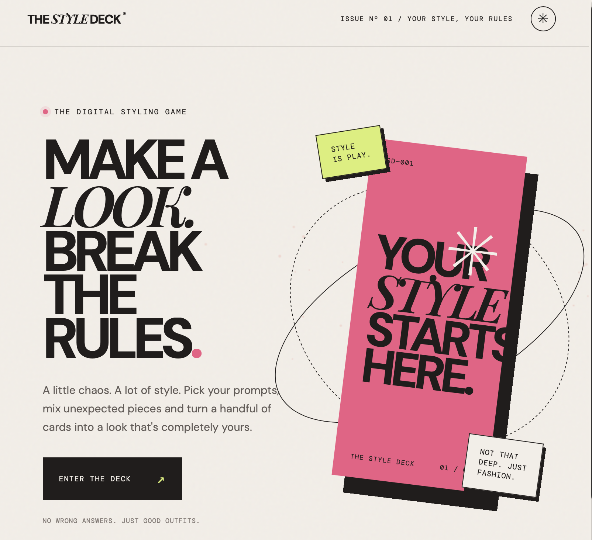

# CART214_AlyciaM

## THE STYLE DECK — Fashion card game

Here you will find my course work for this class

A four-step interactive fashion prompt game built with HTML, CSS, vanilla JavaScript and p5.js.

## Files

- `index.html` — all five screens (welcome, rules, categories, setup, drawn cards)
- `style.css` — responsive editorial / fashion-magazine visual design
- `sketch.js` — p5.js ambient orbit animation
- `app.js` — card decks, random draw logic, 2–5 category selection and round controls
